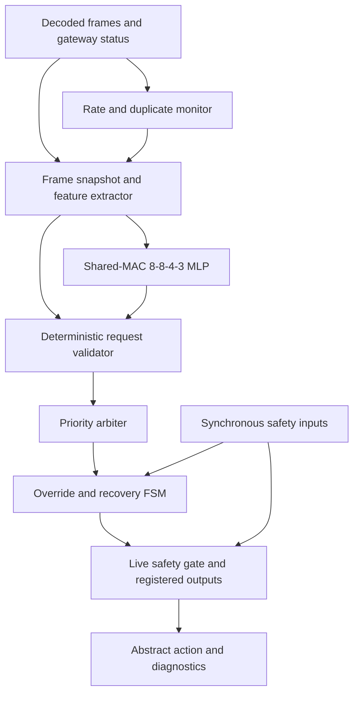
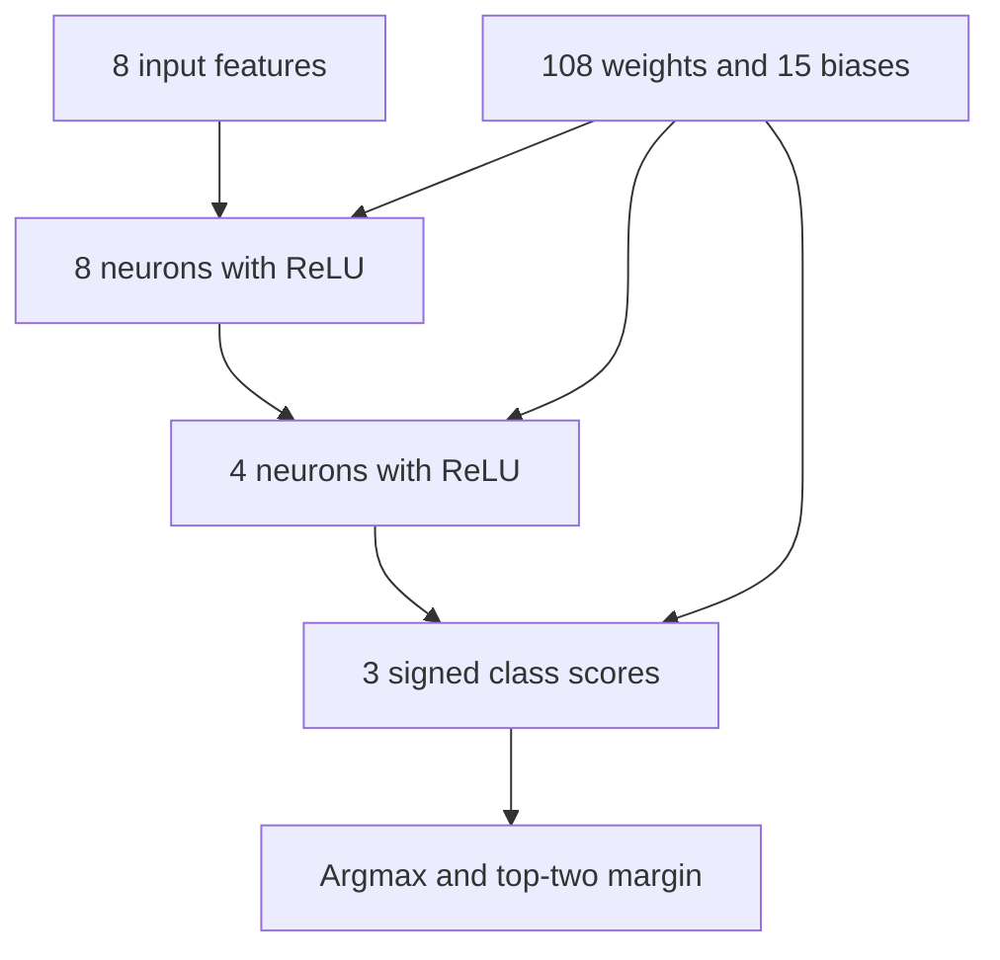
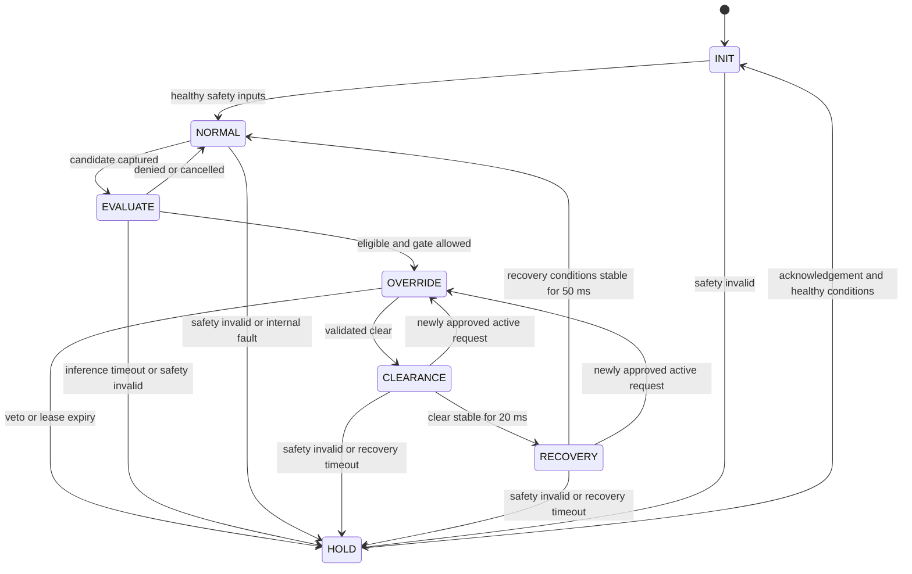

# Neural-Assisted Vehicle Safety Controller with Emergency Override

## Phase 1 specification — version 0.1

Prepared 11 October 2026. Status: architecture proposal ready for implementation review; no RTL, trained model, synthesis result or physical layout is claimed by this document.

**Objective:** build an understandable student ASIC project that receives decoded CAN messages, screens emergency-request patterns with a small neural network, applies deterministic priority and safety checks, and manages override and recovery. The final implementation objective is RTL to GDSII, subject to an available implementation platform.

The intended level is a strong undergraduate/final-year VLSI project: modular Verilog, a small integer inference engine, self-checking verification, and measured implementation trade-offs. A processor, operating system, UVM environment, camera pipeline, full CAN controller and trajectory planner are outside version 1.

## 1. What the controller actually does

An external CAN controller decodes frames. An upstream gateway supplies a validity decision associated with each frame. External safety logic supplies permission to act. This ASIC decides whether an abstract yield request may be issued; it does not generate steering angles or braking forces.

Example: an emergency-request message arrives. The controller checks its format, allowed ID, payload and gateway status, calculates timing/repetition features, and runs the neural classifier. If policy permits and safety permission is present, the FSM enters override. If safety permission disappears, yield is withdrawn. A validated clearance followed by stable recovery conditions is required before returning to normal.

An allowed CAN identifier is a routing/policy check, not sender authentication. An MLP cannot distinguish a malicious message from a legitimate one if all observable features are identical. Upstream validity is an explicit trust assumption, not authentication implemented by this chip.

## 2. Student-sized contribution

The proposed contribution is **confidence-aware request screening with continuously enforced safety permission and stable-clearance recovery**.

1. Confident emergency-like classification can support entry only after deterministic validation.
2. Uncertain, normal or suspicious classifications cannot grant an override. A valid upstream emergency indication remains visible as a pending-emergency diagnostic even when screening denies entry.
3. Safety permission is checked throughout override, not just on entry.
4. Clearance and recovery require consecutive valid observations, reducing mode switching caused by fluctuating clearance inputs.

This combines modest hardware mechanisms; it is not a claim of a globally new algorithm. The experiment must measure switching reduction, added recovery delay, missed requests, and area overhead. A longer delay is a trade-off, not automatically a safety improvement.

## 3. Architecture and responsibilities

The safety gate is logically required for entry and also continuously gates the registered yield output. A one-time entry check is insufficient.

| RTL module | Responsibility |
|---|---|
| `vehicle_safety_top.v` | Connect modules; sample inputs; associate result with captured frame |
| `can_feature_extractor.v` | Decode payload, snapshot metadata and produce eight features |
| `request_monitor.v` | Shared timebase, saturating rate counter, gap and duplicate tracking |
| `mlp_inference.v` | One reused multiply-accumulate datapath, neuron sequencing and score comparison |
| `mlp_parameter_rom.v` | Constant weights/biases exported from the trained model |
| `request_policy_validator.v` | Deterministic eligibility and classifier-margin policy |
| `priority_arbiter.v` | Choose the highest eligible request class |
| `emergency_fsm.v` | Override lifetime, clearance, recovery and fault handling |
| `safety_output.v` | Final safety gate, action encoding and diagnostics |

A MAC multiplies two numbers and adds the product to an accumulator. Reusing one MAC saves arithmetic hardware at the cost of more clock cycles.

## 4. Clock, interface and boundary assumptions

Initial clock target: **20 MHz**, corresponding to a 50 ns period. This is a design target, not achieved timing. Use one clock domain and synchronous active-high reset. Inputs must already be synchronous to `clk`; an external integration wrapper must handle asynchronous sources. Do not synchronize the bits of a multibit frame independently.

Decoded Classical CAN uses an 11-bit identifier and up to eight payload bytes. Version 1 reserves project example ID `11'h120` for emergency messages. This ID is an assumption for simulation, not a standardized vehicle assignment.

| Signal | Width / direction | Definition |
|---|---|---|
| `clk`, `reset` | 1 input each | Rising-edge clock; synchronous reset |
| `can_frame_valid` | 1 input | One-cycle decoded-frame observation pulse |
| `can_id` | 11 input | Standard identifier |
| `can_dlc` | 4 input | Byte length |
| `can_data` | 64 input | Byte 0 in bits 7:0 |
| `can_format_ok`, `can_crc_ok` | 1 input each | Decoder-provided checks; ASIC does not recompute physical-frame CRC |
| `upstream_request_valid` | 1 input | Gateway decision sampled with the observed frame |
| `sensor_valid`, `safe_to_act`, `safety_conflict` | 1 input each | Current synchronous safety status |
| `caution_request`, `elevated_request` | 1 input each | Independent lower-priority abstract requests |
| `recovery_ok`, `fault_ack` | 1 input each | External recovery permission and acknowledgement |
| `classifier_busy` | 1 output | No new classification job can be accepted |
| `decision_valid` | 1 output | One-cycle completion pulse for a captured classification job |
| `decision_code` | 3 output | 0 no request, 1 eligible, 2 invalid, 3 anomalous, 4 uncertain, 5 expired/cancelled, 6 internal error |
| `priority_level` | 2 output | P0 to P3; request priority, not action permission |
| `override_enable` | 1 output | Registered abstract yield permission |
| `action_code` | 2 output | 00 normal, 01 caution, 10 yield, 11 hold/deny-and-alert |
| `emergency_pending` | 1 output | Upstream-valid active request observed, including screening-denied requests |
| `suspicious_traffic`, `uncertain_status` | 1 output each | Latched diagnostics until reset or acknowledged healthy idle |
| `overrun_status`, `fault_status` | 1 output each | Latched overload / fault diagnostic |
| `fsm_state` | 3 output | State encodings below |

`decision_valid` reports request-processing completion; it is not equivalent to `override_enable`. Busy-arrival rejection is reported by `overrun_status`, not a false completion pulse for a job that was never captured.

### Example emergency payload contract

Use DLC=2 for the reserved emergency ID. Byte 0 bit 0 is `request_active`; bit 1 is `request_clear`. Bits 7:2 must be zero. Active and clear cannot both be one. Byte 1 is an application sequence byte. Unused bytes must be zero in this project interface. The gateway validity bit must accompany both active and clear messages.

The sequence byte supports duplicate comparison only. This is not cryptographic anti-replay protection; old messages with plausible sequence values can remain indistinguishable.

### Frames arriving while busy

The monitor observes every `can_frame_valid`, even during inference. Classification has one captured job and no FIFO in version 1. A new frame while busy is not captured for inference; overrun is latched. The active job's metadata and features never change.

A deterministic clearance detector observes all frames independently of MLP busy. A valid clear message cancels a pending active job and initiates clearance of an active override. If active-job completion and clearance coincide, clearance wins. Clearance never grants yield, so it does not require MLP approval.

Flooding may therefore deny service, but must never create an unchecked override. This limitation is reported and tested. The nominal source schedule must leave enough time between inference jobs; no claim of unlimited CAN-line throughput is made.

## 5. Monitoring and eight features

All defaults below are controlled-simulation assumptions, not thresholds extracted from the papers. Configuration is by elaboration parameters in version 1, avoiding an unnecessary register bus.

Create a 1 ms enable pulse with a clock divider. Rate windows are fixed 100 ms windows. Count all observed frames matching the reserved ID, including malformed ones. The current frame is included in its feature snapshot. On a window-boundary edge, reset the count first and then count the arriving frame. Counts saturate; they never wrap.

Rate deny threshold: more than 16 relevant frames per 100 ms. Duplicate deny threshold: four consecutive identical relevant frames, including the current frame. Compare ID, DLC and all payload bits. A different relevant frame starts a run of one; unrelated frames do not reset the run. A gap of at least 100 ms starts a new run. Tumbling windows can miss boundary-straddling bursts; include this limitation in testing.

| Feature | Integer representation, 0 to 127 |
|---|---|
| x0 active request | 127 when decoded active bit is set, otherwise 0 |
| x1 allowed ID | 127 for configured emergency ID, otherwise 0 |
| x2 format valid | 127 for CRC, format, DLC and reserved-field checks passing, otherwise 0 |
| x3 rate | `min(127, 4 * count_including_current)` using widened arithmetic |
| x4 gap | Gap to previous relevant frame in whole ms, saturated at 127; first relevant frame = 127 |
| x5 duplicate run | `min(127, 32 * (run_length - 1))` using widened arithmetic |
| x6 payload plausible | 127 for legal active/clear combination and payload contract, otherwise 0 |
| x7 upstream valid | 127 when captured gateway validity is true, otherwise 0 |

For unrelated frames use rate and duplicate features zero and gap 127; Boolean features retain their defined meanings. Fixed-point input value is `x/128`. Use 8-bit storage with nonnegative values 0..127; do not reinterpret values above 127 as positive signed numbers.

`emergency_pending` is set by a deterministically valid active observation even if classification is busy or denies entry. It clears on validated clearance or expiry 500 ms after its most recent deterministically valid active observation. This diagnostic cannot extend an override lease.

## 6. Neural network and integer arithmetic

Classes: 0 normal, 1 emergency-like, 2 suspicious. Uncertain is a decision status, not a fourth trained class. The model contains 123 parameters and performs 108 weight multiplications per inference.

Initial arithmetic contract:

- Signed 8-bit weights, representing integer weight divided by 128.
- Inputs and hidden activations represent nonnegative integer divided by 128; stored values 0..127.
- Signed 24-bit bias in accumulator scale, quantized by rounding the real bias times 16384. The export routine uses nearest rounding with ties away from zero.
- Signed 16-bit products, explicitly sign-extended into a signed 24-bit accumulator.
- For each neuron, initialize accumulator to its exported bias, then add every product exactly once.
- Hidden activation is `clip(accumulator >>> 7, 0, 127)`. This is arithmetic right shift, with no additional rounding. ReLU means negative results become zero.
- Output scores retain the signed 24-bit accumulator value, with common scale 1/16384; no softmax is required to select the largest score.
- Compute top-score minus second-score in **25 signed bits**. Score ties select the lowest class index for reproducibility, but a zero margin is always uncertain.
- Margin is confident only when `margin > 0` and `margin >= MARGIN_MIN`. Select and export `MARGIN_MIN` on validation data; no calibrated confidence is claimed before this experiment.

Require absolute exported bias <= 2^20. Worst-case magnitude for eight products is at most `8*128*127 = 130048`; adding the bias bound remains below signed 24-bit capacity. Reject an exported model violating the bound. Do not rely on overflow wrapping or silent clipping of an excessive bias.

Use quantization-aware clipping during training or fine-tuning to reflect hidden activation saturation. Uniform scale is a simplicity choice that may reduce accuracy; evaluate it before adding per-layer scales. Parameter storage is constant synthesizable logic/ROM; do not assume the foundry provides a tiny SRAM macro.

Use one shared MAC with explicit LOAD_BIAS, ACCUMULATE and WRITE_RESULT steps and three-score selection. Budget fewer than 160 inference cycles initially; 108 multiplications alone do not imply 108 total cycles. At 20 MHz, 160 cycles corresponds to an 8 microsecond budget, not measured performance. Use a 256-cycle inference watchdog; final cycle counts come from simulation.

## 7. Eligibility, priority and live action policy

Define `D` as captured allowed ID, legal active payload, valid decoder checks and upstream validity. Define `M` as no rate or duplicate violation for the captured observation. Define `C` as class 1 with confident margin. Define `G = sensor_valid && safe_to_act && !safety_conflict`.

| Conditions in full design | Result |
|---|---|
| Not D | Invalid; no new override |
| D and not M | Deny anomalous request; latch diagnostic and retain pending indication |
| D and M, uncertain scores | Deny this candidate; set uncertainty and pending indications |
| D and M, confident class 0 or 2 | Deny; class 2 raises suspicious diagnostic |
| D and M and C, but job cancelled or expired | No entry or lease renewal |
| D and M and C, not G | Eligible emergency retained as diagnostic; hold/deny action |
| D and M and C and G | Enter override or renew existing override lease |

Current rate violation on the completion edge also denies entry/renewal, even if the captured rate passed. Noise on later unrelated frames does not rewrite the captured duplicate feature. Newly rejected traffic does not by itself cancel a previously accepted lease; clearance, lease expiry, fault or safety veto can cancel it.

| Request | Priority |
|---|---|
| Eligible emergency or unexpired accepted emergency lease | P3 |
| `elevated_request` | P2 |
| `caution_request` | P1 |
| None | P0 |

P3 wins simultaneous requests; there is only one emergency source slot. Do not invent ambulance/fire/police ranking. Safety veto takes precedence over every priority. Elevated request maps to hold/alert; caution maps to caution. During clearance, recovery or fault, action is hold/alert regardless of request priority.

Registered `override_enable` can be 1 only when the selected next operating state is OVERRIDE and sampled G is true, no clear/expiry/fault wins, and an accepted unexpired lease exists. A sampled veto withdraws yield at that clock edge. This is synchronous response, not an asynchronous vehicle safety guarantee.

## 8. FSM and temporal rules

Classification runs as an independent transaction machine so monitoring can continue during override. REQUEST_EVALUATION is used for entry from normal; an in-progress renewal does not suspend an existing valid override.

| Code/state | Behaviour and other transitions |
|---|---|
| 0 INIT | Clear control leases and outputs; initialize monitor; go NORMAL when sensor_valid and no conflict, otherwise HOLD |
| 1 NORMAL | Monitor; action follows P0/P1/P2; capture candidate for evaluation |
| 2 EVALUATE | Wait for captured job; failed checks return NORMAL; eligible but unsafe goes HOLD; deadline goes HOLD |
| 3 OVERRIDE | Yield only while G; approved active frames renew lease; denied frames only update diagnostics |
| 4 CLEARANCE | Withdraw yield, latch clear observation and count clear stability; observed valid active resets clear timer even if not yet approved |
| 5 RECOVERY | Hold/alert; require sensor_valid, no conflict, recovery_ok and no pending active request for consecutive recovery ticks |
| 6 HOLD | Withdraw yield, fault_status set; discard any completed old job; acknowledgement cannot authorize override |
| 7 Illegal/reserved | Recover to HOLD and record fault |

Reset from every state enters INIT and forces override off. Global invalid sensor, safety conflict or internal watchdog fault enters HOLD from every state. Loss of safe_to_act while OVERRIDE also enters HOLD. Outside override, safe_to_act false alone does not mean a faulty sensor; it simply prevents entry. Unlisted conditions self-loop. Suspicious traffic is a diagnostic overlay, not a separate FSM state.

Override lease: 500 ms from the last fully accepted active request. Renew only after successful screening and live safety validation. Expiry withdraws override and enters HOLD; it must not silently imply emergency clearance. Same-edge clear beats renewal. Fault/reset beats every transition.

Clearance requires the clear latch to remain set and no valid active observation for 20 consecutive 1 ms ticks. A valid active observation clears that latch; wait for another validated clear. Recovery requires 50 consecutive good ticks; a failed condition resets its counter. Newly approved active requests may reenter override from clearance/recovery only through full policy and G. Denied active requests cannot reenter override.

Total clearance/recovery timeout: 1000 ms after entering CLEARANCE; it continues across CLEARANCE to RECOVERY and cannot be extended by oscillating inputs. Timeout enters HOLD. Fault acknowledgement is accepted only with sensor_valid, no conflict, recovery_ok and no pending emergency, and returns through INIT. These timers are laboratory parameters, not proven real-vehicle safety constants.

## 9. Training and evaluation plan

Start with labelled synthetic traffic episodes because no emergency-labelled dataset is attached. Generate complete streams, not isolated feature rows, then pass them through a reference feature extractor identical to hardware. Save random seed, generator settings, raw observations, labels and split membership.

Split by entire episode/scenario seed, e.g. 60% training, 20% validation and 20% held-out testing. Include unseen timing ranges, boundary bursts, repeated legitimate frames, malformed messages, clear/active conflicts, delayed gateway validity and plausible spoofing cases. Never split adjacent frames from the same episode between train and test.

Labels describe scenario origins and observable pattern classes. Do not label every example using the exact same rate/duplicate thresholds as the hardware and then claim the MLP learned additional security. Explicitly report observationally indistinguishable cases and model limitations.

Train floating-point 8-8-4-3 MLP; quantize/fine-tune; select margin using validation data; export weights, biases and margin; run integer reference inference; compare RTL scores exactly with the reference. Report floating-point and quantized confusion matrices, per-class precision/recall, uncertainty rate, emergency miss rate and false override acceptance. Accuracy on synthetic data is not real CAN intrusion-detection accuracy.

## 10. Verification gates

Use ordinary self-checking Verilog/SystemVerilog testbenches and Python vector generation. UVM is unnecessary for this scope.

| Test group | Required checks |
|---|---|
| Feature arithmetic | First frame, gap saturation, every window boundary, duplicate-run reset and counter saturation |
| MLP arithmetic | Positive/negative products, sign extension, clipping, extreme legal biases, score ties, margin boundary and exact cycle count |
| Interface | Busy arrivals, immutable snapshots, clearance while busy, completion coincident with clearance, reset during inference |
| Policy | Every decision-table row; force class 1 while deterministic checks fail and verify no override |
| Priority | Simultaneous P1/P2/P3; veto at maximum priority |
| FSM | Entry, renewal, expiry, noisy clearance, interrupted recovery, timeout, illegal state and acknowledged recovery |
| Live gate | Remove each safety permission during override; verify synchronous withdrawal |
| Integrated streams | Nominal emergency, legitimate repetitions, bursts, boundary-straddling floods and plausible spoofing |

Key invariants: override implies live gate and accepted lease; no cancelled job renews a lease; timers and counters cannot wrap to bypass a policy; recovery cannot finish early; MLP classifications cannot bypass deterministic validation.

Log every fail and keep waveforms for acceptance, safety veto, clear/recovery and expiry. Measure decision latency from job capture to decision_valid separately from neural start-to-done latency. Functional coverage means scenario/transition coverage unless an actual simulator code-coverage report exists; do not call test pass percentage code coverage.

## 11. Experiments that justify the extra hardware

Use compile-time variants with the same interface, safety gate and FSM:

- A: deterministic format/upstream validator and FSM, no traffic monitor veto or MLP.
- B: A plus rate/duplicate veto.
- C: A plus MLP; retain feature-monitor counters needed by MLP but disable their separate hard veto.
- D: full design with both MLP and hard monitor veto.

C still has feature-extraction cost; it is not honestly described as having no monitor hardware. Separately compare D with recovery stability counts set to one tick versus the configured 20/50 ticks to isolate the recovery contribution.

Measure false accepted overrides, missed valid requests, uncertainty rate, number of mode transitions under chatter, recovery delay, classification latency, controller latency, cell area, setup/hold slack and supported power estimates. Use identical held-out traces and technology constraints. If B performs as well as D, report that the MLP adds implementation cost without a demonstrated benefit on those traces.

## 12. RTL-to-GDSII route and current execution limits

The environment probe found no executable on PATH for Icarus Verilog, Verilator, Yosys, OpenROAD, Magic, KLayout, Netgen, Genus, Innovus or OpenSTA. PDK_ROOT is unset. This is not a search of every possible licensed remote installation, and no remote lab access is assumed.

Authoring RTL, software, testbenches, constraints and implementation scripts is possible. Running them requires the corresponding tools. A simulator installation may make functional verification possible later; it does not provide a foundry PDK or Cadence licence.

Two implementation routes remain valid:

1. University lab: simulate and synthesize with the installed tools, then perform physical design using the lab's authorized technology libraries. Cadence Genus/Innovus is one possible tool pairing; exact scripts depend on the installed versions and library setup.
2. Open-source environment: OpenROAD Flow Scripts provides an RTL-to-GDSII flow using open tools and supported platform data. This is a possible alternative to Cadence, not a completed run in this workspace. Official documentation: https://openroad-flow-scripts.readthedocs.io/en/latest/user/UserGuide.html

Before physical implementation obtain the tool/version, standard-cell Liberty timing files, technology/cell LEF, cell GDS, RC extraction setup, power/ground names, timing corners and relevant DRC/LVS decks. Do not upload proprietary foundry files unless permitted by their licence; paths and error logs often suffice for script adaptation.

Start with a 50 ns clock constraint and explicitly documented I/O budgets, uncertainty, drive and load appropriate to the chosen platform. Do not hide difficult paths with false-path constraints. Initial utilization and floorplan size are implementation choices to revise from actual reports, not research results.

Stages: elaboration and latch checks; functional simulation; synthesis; constraints and setup/hold timing review; floorplan and power network; placement; clock-tree synthesis; routing; extraction and timing; supported DRC/LVS; GDS export. Core-block GDS is the initial objective. An IO pad ring, ESD structures, scan insertion, packaging and manufacturing signoff are additional work, not implied by a routed core.

Keep a results manifest with tool versions, RTL/model hashes, PDK identity, constraints, warnings, area/cell counts, timing, power methodology, DRC/LVS status and GDS path. A GDS file by itself is not proof of signoff.

## 13. Attached literature and missing references

The context names seven papers, but four actual PDFs are attached. Preserve its P1/P2/P4 labels; treat the aging paper as an additional reference R8 rather than silently substituting it for P3.

| Reference | Attachment status and bounded relevance |
|---|---|
| P1: Lee et al., ASIC Design for Real-Time CAN-Bus Intrusion Detection and Prevention System Using Random Forest, IEEE Access, 2025, DOI 10.1109/ACCESS.2025.3585956 | Supplied. Hardware CAN intrusion detection/prevention with Random Forest; motivates actual ASIC evaluation. Our decoded supervisor is not an equivalent integrated CAN-blocking implementation. |
| P2: Choi et al., Shallow Learning-Based Intrusion Detection System for In-Vehicle Network: ASIC Implementation, Electronics 14, 683, 2025, DOI 10.3390/electronics14040683 | Supplied. Lightweight CNN/filter approach; background for compact neural inference. We propose a fully connected MLP. |
| P4: Lin et al., Multiple Emergency Vehicle Priority in a Connected Vehicle Environment: A Cooperative Method, IEEE TITS 25(1), 2024 | Supplied. Cooperative trajectory optimization; motivation for emergency priority, not an algorithm reproduced by our local FSM. |
| R8: Kim et al., CAN-Based Aging Monitoring Technique for Automotive ASICs With Efficient Soft Error Resilience, IEEE Access, 2020, DOI 10.1109/ACCESS.2020.2969258 | Supplied. Aging diagnosis/test access and resilient flip-flop work. Background for automotive reliability; our ordinary RTL watchdog and illegal-state handling do not reproduce its aging monitor or custom cells. |
| P3: Rangsikunpum et al., BNN CAN IDS | Named in context; PDF not supplied. Detailed claims await source verification. |
| P5: Mao et al., cooperative driving and safety rules | Named in context; PDF not supplied. Detailed claims await source verification. |
| P6: Ramani et al., emergency traffic-light FSM | Named in context; PDF not supplied. Detailed claims await source verification. |
| P7: Scheffe et al., dynamic priority trajectory planning | Named in context; PDF not supplied. Detailed claims await source verification. |

This specification uses the papers for scope/background, not numerical claims about this controller. A final literature review requires full source-level checking; the present review is not a claim of exhaustive novelty assessment.

## 14. Work sequence and present status

1. Complete specification review and resolve interface inconsistencies before RTL.
2. Build and verify rule-based variants A/B first.
3. Generate documented episodes, train and export the small integer MLP.
4. Build inference RTL; prove bit-exact agreement with the integer reference by testing.
5. Integrate and run policy/FSM regressions and ablations.
6. Synthesize all variants on the same selected platform.
7. Route the selected design and report physical checks truthfully.
8. Write the report and viva explanation from actual logs/results.

**Completed in this phase:** source-context review, tool-availability probe and proposed architecture/specification. **Not completed:** RTL implementation, training, simulation, synthesis, physical design or GDSII. The next hardware work is the deterministic baseline. The external information needed for platform-specific implementation is the lab tool/version and available technology library.
