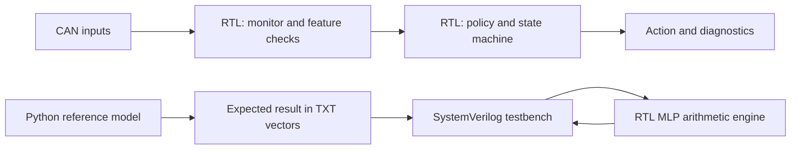

# Beginner's guide to the RTL, Python and text vectors

This guide follows one request through the design and explains how the simulation and Python files fit together. It assumes you are new to Verilog, fixed-point arithmetic and hardware verification.

## 1. The big picture first

There are two kinds of files in this project:

- **RTL (`.v` files):** describe the hardware circuit. After synthesis these are turned into gates/registers; they do not run as ordinary Python programs.
- **Test/model files (`.sv`, `.py`, `.txt`):** help us drive the circuit and check its answer on a computer. They are not all part of the chip.



Python does **not** execute inside the ASIC. It prepares the known-good answers used by the testbench. A later training program will prepare real model numbers and the exporter will write those numbers as synthesizable Verilog ROM logic. That later training program is not part of the current release.

## 2. What happens to one example request?

For the prototype, assume an external CAN controller has already decoded a message and presents:

```text
can_frame_valid         = 1 for one clock
can_id                  = 0x120
can_dlc                 = 2
can_data                = 0x0000000000000101
can_format_ok           = 1
can_crc_ok              = 1
upstream_request_valid  = 1
sensor_valid            = 1
safe_to_act             = 1
safety_conflict         = 0
```

CAN bytes are numbered from the least-significant byte of `can_data`: byte 0 is bits `[7:0]`; byte 1 is `[15:8]`. Thus `0x0101` means byte 0 is `0x01` (active request) and byte 1 is `0x01` (sequence number). The high bytes must be zero in this project example.

1. `request_monitor` sees an observation pulse. It counts the reserved ID in the current 100 ms window and checks whether this entire frame repeats the previous relevant frame.
2. `can_feature_extractor` checks the fixed ID, DLC, reserved payload bits, decoder format/CRC indications and upstream validity. It also builds eight feature bytes for the future MLP.
3. `vehicle_safety_top` captures the current request bit, deterministic-check result and monitor result. This is a snapshot. A later frame cannot change what the currently busy calculation is checking.
4. The default build has `USE_MLP=0`, so its deterministic request result is available on the next clock. The policy module decides whether it is eligible.
5. `emergency_fsm` moves to OVERRIDE only when the request is eligible and the live gate `sensor_valid && safe_to_act && !safety_conflict` is true.
6. The registered outputs become `override_enable=1` and `action_code=2` (abstract yield request). If safety permission disappears during OVERRIDE, the FSM enters HOLD and withdraws yield on the next active clock edge.

This is a decoded input interface. It is not a complete CAN electrical transceiver, and the abstract action output must not be wired directly to real steering/braking hardware.

A clear frame uses byte 0 `0x02`, for example `can_data=0x0000000000000202`. Clear wins over a classification result on the same clock edge. The FSM then requires stable clearance and recovery samples before going to NORMAL.

## 3. Three Verilog ideas that make the source easier to read

### `wire` versus `reg`

A `wire` usually names a signal made by another signal or expression. Example:

```verilog
wire gate_ok = sensor_valid && safe_to_act && !safety_conflict;
```

A `reg` is a variable that a Verilog process assigns. A `reg` does **not always mean a physical register**: if assigned inside a clocked block with `always @(posedge clk)`, it normally represents stored flip-flop state. If assigned in a fully specified `always @*` block, it can represent combinational logic.

### Clocked versus combinational blocks

```verilog
always @(posedge clk) begin
    state <= next_state;
end
```

This says: at the rising clock edge, store the selected next state. Hardware changes at clock edges.

```verilog
always @* begin
    next_state = state;
    if (condition) next_state = NEW_STATE;
end
```

This calculates logic between edges. The default assignment gives `next_state` a value in every case, which avoids accidentally inferring a latch.

### `<=` versus `=`

`<=` (nonblocking assignment) is used for clocked state updates. All right-hand sides use the old clock-edge values, then the updates take effect together. `=` (blocking assignment) is commonly used to calculate temporary values in combinational logic. This old-value/new-value distinction explains many apparently surprising waveforms.

## 4. What each RTL file does

### `rtl/vehicle_safety_top.v` — the wiring and transaction manager

This is the top module that the testbench and Genus elaborate. The signal list at the start is its external interface. It instantiates (“connects”) the submodules by named ports.

Its `#(...)` section contains elaboration parameters: values chosen when the design is built, not runtime software settings. Examples:

- `TICK_CYCLES=20000`: make a 1 ms tick when the clock is 20 MHz.
- `USE_MONITOR=1`: deny a request that crosses the configured rate or repeat limit.
- `USE_MLP=0`: use the deterministic baseline by default.

The top instantiates the monitor, feature extractor, policy validator, FSM and—only in the generate branch when `USE_MLP=1`—the inference core and parameter ROM.

`job_start` means “a frame can be captured for evaluation now.” When this is true, the clocked block copies important live inputs into `captured_requested`, `captured_ok` and `captured_monitor_bad`. Those saved values stay steady while the core is busy. `classifier_busy` marks that interval.

Frames arriving during `classifier_busy` are not queued; `overrun_status` is set. The monitor and valid-clear detector still see those frames. Therefore a clear can cancel an old active job even while the classifier is busy, but a second active message is not saved for later evaluation.

`job_finish` selects the moment when policy is checked. In the deterministic baseline this is the single-cycle path after capture. When using MLP, it is the MLP's `done` pulse, unless a watchdog, clear/cancel or fault intervenes. `decision_valid` is a one-clock report that the evaluation is finished. It is separate from the longer-lived `override_enable` output.

The shipped model ROM says `model_valid=0`. If you turn on `USE_MLP` without replacing it with a real model, `model_error` causes HOLD. This deliberate guard means the zero coefficients cannot accidentally look like a trained model.

### `rtl/request_monitor.v` — counts traffic

This block sees every `can_frame_valid` pulse, including while inference is busy. It only counts `can_id==EMERGENCY_ID` as a relevant request.

- `divider` counts clock cycles until `tick` becomes 1. With 20,000 cycles per tick and a 20 MHz clock, that is 1 ms.
- `window_age` counts ticks to a 100 ms window boundary.
- `rate_count` counts relevant frames in that window.
- `previous_data`, `previous_dlc` and `duplicate_count` track consecutive identical relevant messages.
- `gap_count` counts milliseconds since the last relevant message.

The `*_now` wires include the current input frame in the value presented for that clock edge. Counts saturate at 255 rather than wrapping around to zero. `rate_bad` is true above 16 observations; `duplicate_bad` is true on the fourth identical consecutive observation. Those are project test assumptions, not standard CAN limits.

### `rtl/can_feature_extractor.v` — checks the message and packs eight features

`payload_ok` requires the upper six payload bytes to be zero, byte 0's reserved bits `[7:2]` to be zero, and the active/clear bits not to both be one. `frame_ok` combines that with the expected DLC and external format/CRC results. `deterministic_ok` adds the allowed ID and upstream-valid bit.

The output `features` is **64 bits holding eight 8-bit numbers**, not one ordinary numeric count:

| Feature | Bits | Meaning |
|---|---:|---|
| x0 | `[7:0]` | active bit as 0 or 127 |
| x1 | `[15:8]` | allowed-ID flag as 0 or 127 |
| x2 | `[23:16]` | frame-format flag as 0 or 127 |
| x3 | `[31:24]` | rate count times 4, saturated to 127 |
| x4 | `[39:32]` | gap in milliseconds, saturated to 127; no history is 127 |
| x5 | `[47:40]` | duplicate run score: 0, 32, 64, 96, then 127 |
| x6 | `[55:48]` | payload plausibility flag as 0 or 127 |
| x7 | `[63:56]` | upstream validity flag as 0 or 127 |

The MLP interprets feature byte `q` approximately as the real value `q/128`. For example 127 represents 127/128, approximately 0.992. The selected feature scaling is simple and bounded; later training must use the same procedure.

`valid_active` and `valid_clear` are direct deterministic outputs used by the FSM, independent of neural inference.

### `rtl/request_policy_validator.v` — permission checklist

This is a priority-ordered decision table written as combinational logic. The order matters:

1. Internal error -> code 6.
2. Cancelled job -> code 5.
3. No active request -> code 0.
4. Deterministic message check fails -> code 2.
5. Enabled monitor veto fails -> code 3.
6. Enabled MLP has uncertain margin -> code 4.
7. Enabled MLP class is not confident emergency-like -> code 0 or 3.
8. Otherwise -> `eligible=1`, code 1.

`eligible` is just a request approval input to the FSM. The FSM still checks safety and the live gate. A class-1 MLP result alone never forces the action output.

### `rtl/priority_arbiter.v` — chooses which request ranks highest

Priority is emergency P3, elevated P2, caution P1, normal P0. This is a ranking; the FSM/safety gate decides whether an action may occur. For example, P3 can be the priority during HOLD while `action_code=3` (hold/deny) and `override_enable=0`.

### `rtl/emergency_fsm.v` — stores the operating mode and timers

A finite state machine (FSM) is a small set of named operating modes plus rules for changing mode. The actual states are 3-bit values:

| Number | Name | Plain-language role |
|---:|---|---|
| 0 | INIT | reset/initialization |
| 1 | NORMAL | monitor requests |
| 2 | EVALUATE | wait for the captured job's decision |
| 3 | OVERRIDE | allow abstract yield while gate and lease are valid |
| 4 | CLEARANCE | require stable clear information |
| 5 | RECOVERY | require stable recovery permission |
| 6 | HOLD | fault/unsafe/expired state; no yield |
| 7 | reserved | illegal state is redirected to HOLD |

`state` stores the current state. `next_state` is combinational logic for what the state should be after the next rising clock edge. The timer registers (`lease_left`, `pending_left`, `clear_count`, `recovery_count`, `recovery_age`) are all in 1 ms tick units.

- `lease_left` limits how long one accepted request remains active without a new approved active message.
- `pending_left` drives the separate `emergency_pending` diagnostic.
- `clear_count` and `clear_latched` implement the clearance wait.
- `recovery_count` requires repeated good `recovery_ok` samples.
- `recovery_age` bounds the entire clearance/recovery period so repeated input fluctuations cannot extend it forever.

The global `fault_now` check has high priority: invalid sensor status or a safety conflict takes the controller to HOLD. In OVERRIDE, loss of `safe_to_act` also takes it to HOLD. A reset clears the override output. A valid clear wins over same-edge successful classification; a fault wins over clear; lease expiry wins over a same-edge late renewal.

The timers in simulation are shortened by testbench parameter overrides. Never confuse those fast simulation counts with the default 500 ms / 20 ms / 50 ms / 1000 ms project values.

### `rtl/mlp_inference.v` — the reusable neural arithmetic engine

This module implements inference only. It does not learn or change its weights. It asks an external ROM for one weight and one bias at an address.

The MLP has this shape:

```text
8 input values -> 8 hidden neurons -> 4 hidden neurons -> 3 class scores
```

For each hidden/output neuron it:

1. Sets addresses for that neuron's bias and current weight.
2. Loads the bias into a 24-bit signed accumulator.
3. Reads each input activation and signed weight.
4. Multiplies them to make one signed 16-bit product.
5. Sign-extends the product and adds it to the accumulator.
6. Stores the neuron result. Hidden layers shift right by 7, apply ReLU (negative becomes zero), and clamp to 127. Output-layer scores stay 24-bit signed values.

The core reuses one multiplier and accumulator for all 108 multiplications. This saves duplicated multipliers but takes several cycles. The FSM inside the core uses IDLE, LOAD, MAC, WRITE and SELECT states. One complete call from `start` to `done` takes 139 later rising edges in the tested implementation.

The three outputs mean class 0 normal, class 1 emergency-like, class 2 suspicious. The class is the largest score. The margin is largest score minus second largest. `confident=1` only when the difference is positive and meets `MARGIN_MIN`. It is a numeric score gap, **not a probability**.

### `rtl/mlp_parameter_rom.v` — model-number storage

The current ROM returns zeros and `model_valid=0`. It is a placeholder guard, not the model. Later `ml/export_model.py` writes the trained integer values into constant case statements. Those constants become part of the hardware logic.

## 5. What the Python files do

### `ml/reference_inference.py` — independent software calculator

`infer(features, model)` repeats the MLP math using Python integer arithmetic:

- reads the 8 integer features;
- multiplies and accumulates weights/biases in the same order and widths;
- applies the same hidden right shift/ReLU/clamp;
- calculates three output scores, winning class, margin and confidence.

Python integers do not naturally overflow at 24 bits, so this function explicitly checks that the intended score is within the allowed signed 24-bit range. It is the software “answer key” for verification. It does **not** train the model.

### `ml/generate_test_vectors.py` — makes arithmetic homework for the RTL

This file uses the deterministic random seed `20261011`. For each of 1,024 cases, it prepares:

- eight input feature bytes;
- 108 signed 8-bit weights;
- 15 signed 24-bit biases;
- the three expected scores;
- expected class, margin and confidence.

Most cases are repeatable pseudo-random arithmetic combinations. The first few are hand-designed edge cases: all-zero parameters produce a tie, alternating extreme signed weights test negative arithmetic and wide accumulation, and biases near the confidence threshold test whether `>=` versus `>` behaves correctly.

The script calls `reference_inference.infer` to calculate expected answers. It does not contain labels such as “ambulance” or “attack” and does not measure classification accuracy. These cases test the math implementation only.

### `ml/export_model.py` — converts a future model into RTL

Once an external training/quantization step has produced a JSON file, run:

```bash
python3 ml/export_model.py path/to/trained_model.json --output rtl/mlp_parameter_rom.v
```

It checks that the JSON contains exactly 108 weights, 15 biases, legal ranges, `model_status="trained_quantized"` and training provenance in `training_manifest`. Then it emits Verilog case statements that return the weight/bias at each address and sets `model_valid=1`.

There is currently no training/quantization script in the kit, so this exporter is an interface for a later phase. The intentional guard rejects random fixtures and arbitrary unlabelled coefficients.

### `scripts/run_tests.py` — test manager

This script is the top-level simulation helper. It does **not** synthesize RTL. It:

1. Changes to the project root so file paths work consistently.
2. Runs `ml/generate_test_vectors.py` to recreate the text file.
3. Reads the RTL order from `rtl/files.f`.
4. Compiles each SystemVerilog testbench as a separate simulation top.
5. Runs Icarus or Xcelium, writes a log, and stops at the first failure.
6. Writes `reports/verification_summary.json` after every test passes.

Run from the project folder:

```bash
python3 scripts/run_tests.py xcelium
```

For one simulation top manually, the pattern is:

```bash
xrun -64bit -sv -access +rwc -f rtl/files.f tb/tb_controller.sv -top tb_controller
```

### `scripts/check_structure.py` — optional Yosys checks

This script asks Yosys to parse/elaborate RTL, convert procedural blocks, check for structural errors, assert that no latch cell exists, and print generic cells. It is not needed for Xcelium simulation and is not ASIC synthesis. It does not select your 45 nm/90 nm library and does not give valid cell area/timing for your college PDK.

## 6. How `mlp_vectors.txt` is laid out

Each non-empty line is **one complete test case**. Spaces separate fields. The exact field order is:

| Field position | Count | Width/format | Meaning |
|---|---:|---|---|
| 1 | 1 | 16 hex digits | eight feature bytes packed into 64 bits; x0 is the rightmost byte |
| 2 to 109 | 108 | 2 hex digits each | signed 8-bit weights, two's-complement bit pattern |
| 110 to 124 | 15 | 6 hex digits each | signed 24-bit biases, two's-complement bit pattern |
| 125 to 127 | 3 | 6 hex digits each | expected signed 24-bit score0, score1, score2 |
| 128 | 1 | 1 hex digit | expected class 0, 1 or 2 |
| 129 | 1 | 7 hex digits | expected 25-bit score margin |
| 130 | 1 | decimal digit | expected confidence flag 0 or 1 |

Why are parameters and inputs on the same row? Because the testbench loads those numbers into its external ROM arrays, starts the RTL core for one feature vector, waits for `done`, and compares its outputs with the expected values at the end of that row. A real chip would not receive weights on every inference; the verification bench supplies different test models so many arithmetic conditions can be tested without changing the RTL.

### Reading the first row

The first field of row 1 is:

```text
5b0a0e47567e587d
```

Hexadecimal `7d` is the least-significant byte, so the eight features from x0 to x7 are:

```text
x0=0x7d, x1=0x58, x2=0x7e, x3=0x56,
x4=0x47, x5=0x0e, x6=0x0a, x7=0x5b
```

This first special case then has all-zero weights and biases. So all three scores are zero, tie-breaking selects class 0, the margin is zero and confidence is false. That is a useful tie/uncertainty check, not a claim that arbitrary real traffic is class 0.

Row 3 and row 4 test the confidence boundary: zero weights, zero hidden values, output-class-1 bias set to 255 or 256, and `MARGIN_MIN=256`. The first should have class 1 but confidence false; the second should have class 1 and confidence true. The reason is the exact `margin >= MARGIN_MIN` rule.

### Two's complement, in simple terms

The text file writes raw bits in hex. For an 8-bit signed weight, `00` is zero, `01` is +1, `7f` is +127 and `80` is -128. Hex `ff` is -1 when interpreted as a signed 8-bit value.

For the 24-bit signed bias/score, `000001` is +1 and `ffffff` represents -1. The SystemVerilog testbench declares these arrays `reg signed`, so `$fscanf` stores the bit pattern and Verilog interprets it as signed during multiplication/addition.

## 7. How the vector file reaches the hardware simulation

`tb/tb_mlp.sv` contains the bridge:

1. `$fopen("vectors/mlp_vectors.txt","r")` opens the text file.
2. `$fscanf(..., "%h", features)` reads the packed feature word.
3. A loop reads 108 values into `weights[0:107]`.
4. Another loop reads 15 values into `biases[0:14]`.
5. It reads three expected scores, class, margin and confidence.
6. It drives `start=1` for a clock and the core captures the features.
7. `weight_address` selects an entry from the testbench's `weights` array. `bias_address` selects an entry from `biases`. Those arrays act as a simulation ROM.
8. The testbench waits for `done`, then uses `!==` comparisons. `!==` also fails if a result contains an unknown `X` bit.
9. The testbench checks the exact score/class/margin/confidence and verifies 139 inference cycles.

So the connection is:

```text
Python random case -> Python integer answer -> one TXT row
                     -> SystemVerilog reads row -> simulated ROM + features
                     -> MLP RTL computes -> testbench compares with answer
```

If any score differs, the simulator prints the failing vector index and actual/expected scores, then calls `$fatal` to stop. If all 1,024 cases pass, the core's fixed-point arithmetic agrees with the reference on those cases. It does not mean the network is accurate on traffic.

## 8. What each testbench checks

| File | Beginner's summary |
|---|---|
| `tb_monitor.sv` | Traffic counters include the current frame, saturate instead of wrapping, reset duplicate history after a long gap, and handle a window boundary. |
| `tb_features.sv` | Checks all 256 possible monitor byte values against feature-scaling rules and tests valid/invalid payload cases. |
| `tb_policy.sv` | Exhaustively tries all 256 combinations of its Boolean/class inputs and compares the decision table with the expected result. |
| `tb_fsm.sv` | Drives the FSM directly to test timing boundaries: override, clear, recovery, expiry, fault and acknowledgement. |
| `tb_controller.sv` | Tests the full default top in many realistic scenarios: accept, reject, safety veto, traffic burst, duplicates, renew/expire, recover and clear while busy. It also writes the VCD waveform. |
| `tb_mlp.sv` | Loads the 1,024 text cases and checks the standalone neural arithmetic core. |
| `tb_neural_adapter.sv` | Enables the neural path, checks that the invalid placeholder model fails closed and that even a forced class-1 result cannot bypass deterministic checks. Hierarchical force is only a testbench technique. |

The checks are useful examples; their number is not a code-coverage percentage. This is not a UVM environment or a formal proof.

## 9. A useful order for learning the code

1. Read `rtl/files.f`: this is the list of design modules, in compile order.
2. Read the port list of `vehicle_safety_top.v` and the signal table in the other walkthrough.
3. Read `can_feature_extractor.v`, which is mostly Boolean checks and byte assignments.
4. Read `request_policy_validator.v`, a small decision table.
5. Read `priority_arbiter.v`, then trace its output into `emergency_fsm.v`.
6. Run `tb_fsm.sv` before reading the longer `tb_controller.sv`.
7. Read `request_monitor.v` and watch its counters in `build/controller.vcd`.
8. Read `mlp_inference.v` with the FSM states printed next to you: IDLE -> LOAD -> MAC -> WRITE -> SELECT.
9. Read Python `reference_inference.py`, then compare its loops with the RTL's layer/neuron counters.
10. Finally read `tb_mlp.sv`; it shows exactly how the text values become hardware inputs.

## 10. Commands you need

From the folder containing `README.md`:

```bash
python3 scripts/run_tests.py xcelium
```

This runs all seven testbenches and regenerates `vectors/mlp_vectors.txt`. If you want just the MLP arithmetic test, from the same project root use:

```bash
xrun -64bit -sv -access +rwc -f rtl/files.f tb/tb_mlp.sv -top tb_mlp
```

The Xcelium commands should run after loading your college's normal Cadence environment. For waveform viewing, `tb_controller` creates `build/controller.vcd` when its `+WAVES` argument is passed. In SimVision the optional SHM script is a starter and may need syntax changes for the version installed in your lab.

## 11. The current and future boundary

**Included now:** RTL, functional simulation, arithmetic reference, deterministic synthetic arithmetic vectors, and model-ROM exporter.

**Still a later project phase:** collect/generate labelled traffic episodes; write and validate a training/quantization pipeline; create a provenance manifest; export the trained model; repeat bit-exact RTL comparison; evaluate classification on a held-out split; measure Genus area/timing; perform Conformal, Innovus and Tempus runs using the actual lab library.

The random weights in the TXT rows only make varied math tests. They are not a trained MLP. `ml/generate_test_vectors.py` and `ml/reference_inference.py` are not training scripts. A passing vector test proves agreement between two calculations, not that the calculation detects genuine emergencies or attacks.
